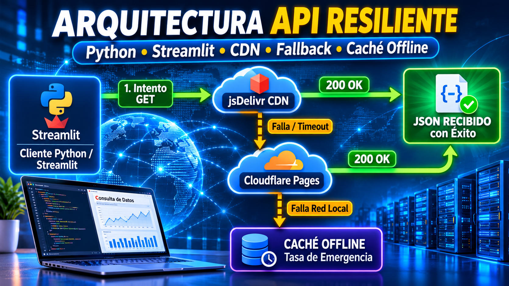

# 📘 Manual Maestro: Creación de Repositorio en GitHub y Despliegue en Streamlit Cloud
### *Guía Definitiva Paso a Paso: Método Manual (Arrastrar y Soltar), Método por Comandos (Git CLI) y Publicación en la Nube con Sincronización en Vivo de Excel*

[](https://github.com/)
[](https://git-scm.com/)
[](https://share.streamlit.io/)
[](https://share.streamlit.io/deploy?repository=JUANCITOPENA/APIs-Python-Casos-Reales-Excel-Streamlit&branch=main&mainModule=app.py)
[](https://github.com/JUANCITOPENA)

---

## 🎯 Objetivo del Manual

Este manual ha sido elaborado para que cualquier estudiante, desarrollador o analista de datos aprenda **desde cero y sin frustraciones** a:
1. Subir su proyecto local a un repositorio oficial en **GitHub** utilizando **dos métodos alternativos**:
   * **Método 1 (Gráfico / Principiantes):** Arrastrar y soltar (*Drag & Drop*) directamente desde el navegador web.
   * **Método 2 (Terminal / Profesional):** Mediante comandos estándar de **Git** en la consola.
2. Desplegar la aplicación web interactiva en la nube de forma **100% gratuita** utilizando **Streamlit Community Cloud**, dejándola disponible en internet con una URL pública accesible desde cualquier computadora o teléfono móvil.
3. Configurar la **sincronización en vivo de datos**: cada vez que actualices el libro Excel en GitHub con nuevos registros, Streamlit los consumirá en caliente sin necesidad de reinstalar ni reiniciar la aplicación.

---

## 🏛️ Arquitectura del Flujo de Datos

<div align="center">
  
  <p><em><strong>Diagrama de Flujo:</strong> El libro Excel vive en GitHub y es consumido directamente por Streamlit Cloud mediante peticiones HTTP GET, combinándolo con la tasa de divisas en tiempo real.</em></p>
</div>

---

## 🖱️ MÉTODO 1: Creación y Subida Manual en GitHub (Arrastrar y Soltar)

Este método es ideal si no tienes Git instalado en tu computadora o si prefieres una interfaz 100% visual en el navegador.

### Paso 1.1: Iniciar sesión en GitHub y crear el repositorio
1. Abre tu navegador web e ingresa a [https://github.com](https://github.com).
2. Inicia sesión con tu usuario (por ejemplo, **JUANCITOPENA**).
3. En la esquina superior derecha, haz clic en el icono **`+`** y selecciona **"New repository"** (o ingresa directamente a [https://github.com/new](https://github.com/new)).

### Paso 1.2: Configurar los datos del repositorio
Completa los campos tal como se indica a continuación:
* **Repository name:** `APIs-Python-Casos-Reales-Excel-Streamlit` *(o el nombre alusivo que prefieras)*.
* **Description:** `Ecosistema de APIs en Python con casos reales: monitor de divisas, pipeline ETL con Excel contable y dashboard ejecutivo en Streamlit Cloud.`
* **Visibility:** Selecciona **`Public`** (obligatorio para desplegar gratis en Streamlit Cloud).
* ⚠️ **MUY IMPORTANTE (Atención aquí):**
  * **NO** marques la casilla *"Add a README file"*.
  * **NO** agregues `.gitignore`.
  * **NO** elijas licencia en este paso.
  *(Debe crearse un repositorio totalmente vacío para que GitHub te muestre la pantalla de subida manual).*
4. Haz clic en el botón verde **"Create repository"**.

### Paso 1.3: Acceder a la zona de carga de archivos
Al crearse el repositorio vacío, verás una pantalla con instrucciones de código. Busca el enlace que dice:
> *"Get started by creating a new file or **uploading an existing file**."*

Haz clic directamente en el texto azul **"uploading an existing file"**.

### Paso 1.4: Arrastrar los archivos del proyecto
1. Abre el **Explorador de Archivos de Windows** y navega a la carpeta de tu proyecto:
   `C:\Users\User\Desktop\USO DE API CON PYTHON, REPO EXCEL EN GITHUB  + DASHBOARD EN STREAMLIT`
2. Selecciona los siguientes archivos clave:
   * ✅ `app.py` *(Dashboard principal con sincronización viva a GitHub)*
   * ✅ `estados_financieros_rd_Streamlit_GitHub.py` *(Versión especializada en consumo desde GitHub)*
   * ✅ `estados_financieros_rd_Stramlit.py` *(Código base del dashboard)*
   * ✅ `estados_financieros_rd.py` *(Pipeline ETL de consola)*
   * ✅ `divisas.py` *(Monitor de tasas de divisas)*
   * ✅ `estados_financieros_rd.xlsx` *(Libro contable maestro)*
   * ✅ `requirements.txt` *(Lista de dependencias)*
   * ✅ `arquitectura_api_resiliente.png` *(Diagrama arquitectónico)*
   * ✅ `resultado_proyecto1_divisas.png` *(Captura de consola 1)*
   * ✅ `resultado_proyecto2_etl_excel.png` *(Captura de consola 2)*
   * ✅ `resultado_proyecto3_dashboard_streamlit.png` *(Captura del dashboard en vivo)*
   * ✅ `README.md`
   * ✅ `MANUAL_CREACION_REPO_Y_DESPLIEGUE.md`
   * ✅ Las guías adicionales con extensión `.md`
3. Arrástralos con el ratón y suéltalos dentro del recuadro punteado de GitHub que dice:  
   **"Drag files here to add them to your repository"**.
4. Verás una barra de progreso mientras los archivos se cargan al servidor.

> 🚫 **REGLA DE ORO / ADVERTENCIA CRÍTICA:**  
> **NUNCA arrastres la carpeta `venv`**. Esa carpeta contiene miles de archivos temporales del entorno virtual de tu computadora que pesan cientos de megabytes. GitHub bloqueará la subida o tu repositorio quedará dañado.

### Paso 1.5: Guardar el Commit inicial
1. En la parte inferior de la página, en la sección **"Commit changes"**:
   * En el título escribe: `feat: carga de ecosistema de APIs, ETL Excel y Streamlit Cloud sincronizado`
   * En la descripción (opcional): `Incluye diagramas, capturas de ejecución real y consumo directo desde GitHub.`
2. Asegúrate de que esté seleccionada la opción **"Commit directly to the main branch"**.
3. Haz clic en el botón verde **"Commit changes"**.
4. ¡Listo! En unos segundos verás tu repositorio completamente estructurado con su `README.md` formateado e imágenes operativas.

---

## 💻 MÉTODO 2: Creación y Subida Profesional con Comandos de Git (CLI)

Este es el estándar industrial utilizado por ingenieros de software, automatizable y perfecto para versionar cambios continuos.

### Paso 2.1: Verificar Git y configurar identidad
Abre tu terminal (**PowerShell** o **Git Bash**) y confirma que tienes Git instalado:
```bash
git --version
```
Si es la primera vez que usas Git en esta máquina, define tu nombre y correo:
```bash
git config --global user.name "JUANCITOPENA"
git config --global user.email "juancito.pena.v@hotmail.com"
```

### Paso 2.2: Ubicarse en la carpeta del proyecto
```powershell
Set-Location "C:\Users\User\Desktop\USO DE API CON PYTHON, REPO EXCEL EN GITHUB  + DASHBOARD EN STREAMLIT"
```

### Paso 2.3: Inicializar el repositorio Git
```bash
git init
```
*(Esto creará la carpeta oculta `.git` donde se almacenará el historial de versiones).*

### Paso 2.4: Crear el archivo `.gitignore`
Para evitar subir archivos innecesarios como el entorno virtual o cachés de Python, crea el archivo `.gitignore` con este contenido:
```text
# Entorno virtual
venv/
env/
.venv/

# Caché de Python
__pycache__/
*.pyc

# Archivos de sistema operativo e IDEs
.DS_Store
Thumbs.db
.vscode/
.idea/
```

### Paso 2.5: Agregar los archivos al área de preparación (*Staging Area*)
```bash
git add .
```
*(El punto `.` indica que se agregarán todos los archivos respetando las exclusiones del `.gitignore`).*

### Paso 2.6: Registrar el primer commit
```bash
git commit -m "feat: initial commit con arquitectura de APIs, Excel ETL y Streamlit Dashboard"
```

### Paso 2.7: Renombrar la rama principal a `main`
```bash
git branch -M main
```

### Paso 2.8: Crear el repositorio remoto en GitHub
1. Ve a [https://github.com/new](https://github.com/new).
2. Crea el repositorio con el nombre: `APIs-Python-Casos-Reales-Excel-Streamlit` en modo **`Public`** (sin marcar README ni `.gitignore`).
3. Copia la URL del repositorio creado:
   `https://github.com/JUANCITOPENA/APIs-Python-Casos-Reales-Excel-Streamlit.git`

### Paso 2.9: Vincular el repositorio remoto y subir el código
En tu terminal ejecuta:
```bash
git remote add origin https://github.com/JUANCITOPENA/APIs-Python-Casos-Reales-Excel-Streamlit.git
git push -u origin main
```

---

## ☁️ CÓMO PUBLICAR EL DASHBOARD EN STREAMLIT COMMUNITY CLOUD

Una vez que tu repositorio está subido en GitHub, el despliegue en la nube toma menos de 2 minutos y es totalmente gratuito.

### ⚡ Opción A (Recomendada): Enlace Directo de 1 Solo Clic (Pre-Configurado)

Puedes usar el enlace de despliegue directo oficial de Streamlit, el cual ya tiene todos los parámetros de tu repositorio precargados:

<div align="center">
  <a href="https://share.streamlit.io/deploy?repository=JUANCITOPENA/APIs-Python-Casos-Reales-Excel-Streamlit&branch=main&mainModule=app.py" target="_blank">
    
  </a>
  <p>🔗 <strong>URL de Despliegue Directo:</strong><br>
  <a href="https://share.streamlit.io/deploy?repository=JUANCITOPENA/APIs-Python-Casos-Reales-Excel-Streamlit&branch=main&mainModule=app.py" target="_blank">
    <strong>https://share.streamlit.io/deploy?repository=JUANCITOPENA/APIs-Python-Casos-Reales-Excel-Streamlit&branch=main&mainModule=app.py</strong>
  </a></p>
</div>

*(Al abrir el enlace, Streamlit reconocerá automáticamente el repositorio, rama y archivo ejecutable, por lo que solo tendrás que presionar el botón azul **"Deploy!"**).*

---

### 📋 Opción B: Configuración Manual Paso a Paso

### Paso 3.1: Entrar a Streamlit Community Cloud
1. Abre tu navegador y dirígete a: [https://share.streamlit.io](https://share.streamlit.io).
2. Haz clic en **"Sign in"** o **"Continue with GitHub"**.
3. Autoriza la conexión para que Streamlit pueda leer tus repositorios públicos de GitHub.

### Paso 3.2: Iniciar un nuevo despliegue
En tu panel principal de Streamlit (*Workspace*), haz clic en el botón azul superior:
👉 **"Create app"** (o **"New app"**).

Si te da opciones, selecciona:
* **"Deploy a public app from GitHub"** (o *"I already have an app"*).

### Paso 3.3: Configurar los parámetros del despliegue
Se presentará un formulario con tres casillas obligatorias:

1. **Repository:**
   Escribe o selecciona tu repositorio en la lista desplegable:
   ```text
   JUANCITOPENA/APIs-Python-Casos-Reales-Excel-Streamlit
   ```
2. **Branch:**
   Escribe la rama principal:
   ```text
   main
   ```
3. **Main file path:**
   Indica el archivo ejecutable de la aplicación:
   ```text
   app.py
   ```
   *(Tanto `app.py` como `estados_financieros_rd_Streamlit_GitHub.py` contienen la lógica de consumo en vivo desde GitHub).*

4. **App URL (Opcional - Personalización):**
   Puedes hacer clic en *"Advanced settings"* o en el lápiz de edición de la URL para asignarle un nombre personalizado, por ejemplo:
   `https://finanzas-api-rd.streamlit.app`

### Paso 3.4: Desplegar la aplicación
Haz clic en el botón azul:
🚀 **"Deploy!"**

### Paso 3.5: Monitorear el proceso de construcción (*Build Logs*)
1. En la esquina inferior derecha verás un icono de terminal o un globo flotante que dice *"Your app is baking"*.
2. Puedes hacer clic en **"Manage app"** -> **"View logs"** para ver cómo el servidor de Streamlit ejecuta:
   * Clonación de tu repositorio desde GitHub.
   * Detección automática del archivo `requirements.txt`.
   * Instalación de las librerías: `streamlit`, `pandas`, `openpyxl`, `requests`, `plotly`.
   * Puesta en marcha del proceso con `streamlit run app.py`.
3. En aproximadamente **45 a 90 segundos**, la pantalla cambiará y verás tu **Dashboard Financiero Interactivo** funcionando en vivo.

---

## 🔄 ¿Cómo Funciona la Sincronización Automática con GitHub?

El dashboard incorpora un motor de lectura de datos en tiempo real:

```python
URL_EXCEL_GITHUB = "https://raw.githubusercontent.com/JUANCITOPENA/APIs-Python-Casos-Reales-Excel-Streamlit/main/estados_financieros_rd.xlsx"
```

1. **Cada vez que agregas más filas al Excel y haces push a GitHub:**
   * La versión pública en `raw.githubusercontent.com` se actualiza inmediatamente.
2. **En Streamlit Cloud:**
   * La función `descargar_excel_github` tiene un tiempo de vida (*TTL*) de 60 segundos con parámetros anticaché (`?v=timestamp`).
   * Pasados 60 segundos, o simplemente presionando el botón **"🔄 Refrescar datos desde GitHub"** en la barra lateral, Streamlit purga su memoria caché y recarga los nuevos balances y estados de resultados automáticamente.
   * **¡Cero necesidad de reiniciar el servidor ni reinstalar dependencias!**

---

## 🛠️ Preguntas Frecuentes y Resolución de Incidencias

| Problema detectado | Causa probable | Solución inmediata |
| :--- | :--- | :--- |
| **`ModuleNotFoundError: No module named 'plotly'`** | El archivo `requirements.txt` falta o tiene errores tipográficos en el nombre de la librería. | Asegúrate de que `requirements.txt` esté en la raíz del repositorio con `plotly`, `pandas`, `openpyxl`, `requests` y `streamlit`. |
| **`FileNotFoundError: estados_financieros_rd.xlsx`** | El archivo Excel no se subió a la raíz del repositorio en GitHub. | Verifica en la pestaña *"Code"* de GitHub que el archivo `.xlsx` esté presente con el nombre exacto. |
| **La app tarda mucho en cargar o se duerme** | Las apps gratuitas de Streamlit se suspenden (*sleep*) tras varios días de inactividad. | Al ingresar a la URL, simplemente haz clic en el botón *"Yes, get this app back up!"* y despertará en 30 segundos. |
| **Error al subir archivos por Git: `remote origin already exists`** | Ya tenías un enlace remoto previo configurado. | Ejecuta: `git remote remove origin` y luego vuelve a vincularlo con `git remote add origin <URL>`. |

---

<!-- =========================================================================
     SECCIÓN OFICIAL: BIOGRAFÍA PROFESIONAL, STACK Y FOOTER INSTITUCIONAL JPV
========================================================================== -->

<table width="100%" cellpadding="12" cellspacing="0" style="border: 2px solid #000000; border-collapse: collapse; background-color: #FFFFFF;">
<tr>
<td width="58%" valign="top" style="border-right: 1.5px solid #000000; padding: 18px;">

<table width="100%" cellpadding="0" cellspacing="0" style="border: none;">
<tr>
<td width="95" valign="top">
  <a href="https://github.com/JUANCITOPENA">
    
  </a>
</td>
<td valign="top" style="padding-left: 12px;">
  <h3 style="margin: 0 0 6px 0; color: #000000;">Ing. Juancito Peña Vizcaíno</h3>
  <a href="#"></a>
  <a href="#"></a>
  <a href="#"></a>
  <a href="#"></a>
</td>
</tr>
</table>

<p style="color: #0F172A; font-size: 13.5px; line-height: 1.6; margin-top: 14px;">
<strong>Ingeniero en Sistemas y Computación</strong> con Postgrado en <strong>Ingeniería de Software</strong> y Maestría en <strong>Sistemas Mención Gerencial</strong> (<em>Universidad Dominicana O&M</em>). Con más de <strong>15 años de trayectoria</strong>, transformo problemas de alta complejidad en soluciones escalables. Durante el último año, he centrado mi trabajo en <strong>I+D+i (Investigación, Desarrollo e Innovación)</strong>, explorando arquitecturas de <strong>IA Generativa (RAG / LLMs)</strong>, integración de agentes autónomos con bases de datos y orquestación de APIs empresariales.
</p>

<p style="color: #0F172A; font-size: 13.5px; line-height: 1.6; margin-bottom: 0;">
🔬 <strong>Mi motor es el aprendizaje a través de los retos:</strong> me apasionan los <em>casos de uso reales</em>, las <strong>pruebas técnicas rigurosas</strong>, la investigación profunda y el diseño de soluciones directas a problemas de ingeniería. 🎓 Como <strong>docente universitario</strong> y creador del canal educativo <strong><a href="https://www.youtube.com/@JuancitoDevV">@JuancitoDevV</a></strong>, comparto este conocimiento práctico mediante ejercicios y proyectos de código abierto para acercar la tecnología a problemas reales. 🚀
</p>

</td>
<td width="42%" valign="top" style="padding: 18px;">

<h4 style="margin: 0 0 10px 0; color: #000000;">⚡ Ecosistema de Tecnologías:</h4>

<p style="margin: 0 0 8px 0; font-size: 12.5px; line-height: 1.5;">
<strong>🖥️ Frontend & Web:</strong><br>
<code>HTML5</code> • <code>CSS3</code> • <code>JavaScript</code> • <code>React</code> • <code>Next.js</code><br>


</p>

<p style="margin: 0 0 8px 0; font-size: 12.5px; line-height: 1.5;">
<strong>⚙️ Backend & Multiplataforma:</strong><br>
<code>C#</code> • <code>.NET / MAUI</code> • <code>Python</code> • <code>PHP</code><br>


</p>

<p style="margin: 0 0 8px 0; font-size: 12.5px; line-height: 1.5;">
<strong>📊 Data Analytics & Bases de Datos:</strong><br>
<code>SQL Server</code> • <code>PostgreSQL</code> • <code>MySQL</code> • <code>Power BI</code><br>


📊
</p>

<p style="margin: 0 0 12px 0; font-size: 12.5px; line-height: 1.5;">
<strong>🤖 IA + APIs & Despliegue (I+D+i):</strong><br>
<code>APIs REST</code> • <code>LLMs (RAG)</code> • <code>Agentes IA</code> • <code>Git</code> • <code>GitHub</code> • <code>Vercel</code><br>
🔌 🧠 🤖


▲
</p>

<h4 style="margin: 12px 0 6px 0; color: #000000;">Canales Oficiales & Redes:</h4>

<p style="margin: 0 0 10px 0;">
  <a href="https://www.linkedin.com/in/juancitope%C3%B1a/"></a>
  <a href="https://www.youtube.com/@JuancitoDevV"></a>
  <a href="https://github.com/JUANCITOPENA"></a>
  <a href="https://twitter.com/JuancitoPenaV"></a>
  <a href="mailto:juancito.pena@gmail.com"></a>
</p>

<table width="100%" cellpadding="6" cellspacing="0" style="border: 1.5px solid #000000; background-color: #F8FAFC;">
<tr>
<td>
  <small style="color: #DC2626; font-weight: bold; display: block;">Canal Educativo de YouTube:</small>
  <a href="https://www.youtube.com/@JuancitoDevV" style="font-weight: bold; color: #000000; text-decoration: none; font-size: 13px;">
    ▶️ @JuancitoDevV · Algoritmos, SQL, IA & .NET ↗
  </a>
</td>
</tr>
</table>

</td>
</tr>
</table>

<table width="100%" cellpadding="12" cellspacing="0" style="border: 2px solid #000000; border-top: none; background-color: #F1F5F9;">
<tr>
<td width="75%">
  <span style="background-color: #000000; color: #FFFFFF; padding: 2px 8px; font-size: 11px; font-weight: bold; margin-right: 8px;">PROYECTO OFICIAL JPV</span>
  <strong>Sistemas, Datos & Arquitectura de Software</strong>
  <p style="margin: 4px 0 0 0; font-size: 12px; color: #475569;">
    Plataforma de grado industrial desarrollada bajo estándares de alto rendimiento, accesibilidad universal y diseño limpio.
  </p>
  <p style="margin: 4px 0 0 0; font-size: 11px; color: #64748B;">
    <strong>Aviso Académico & Autoría:</strong> Diseñado, desarrollado y certificado por el <strong>Ing. Juancito Peña Vizcaíno</strong>. Todos los derechos reservados.
  </p>
</td>
<td width="25%" align="right" valign="middle">
  <a href="#top" style="color: #DC2626; font-weight: bold; text-decoration: none; font-size: 13px;">
    ⬆️ Volver al Inicio
  </a>
</td>
</tr>
</table>
