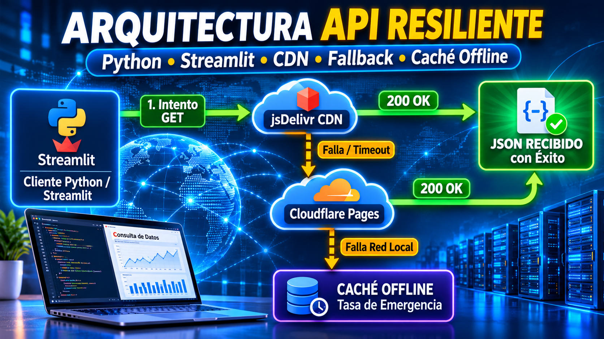
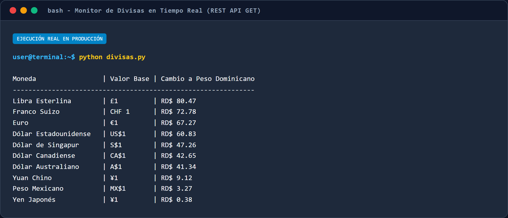
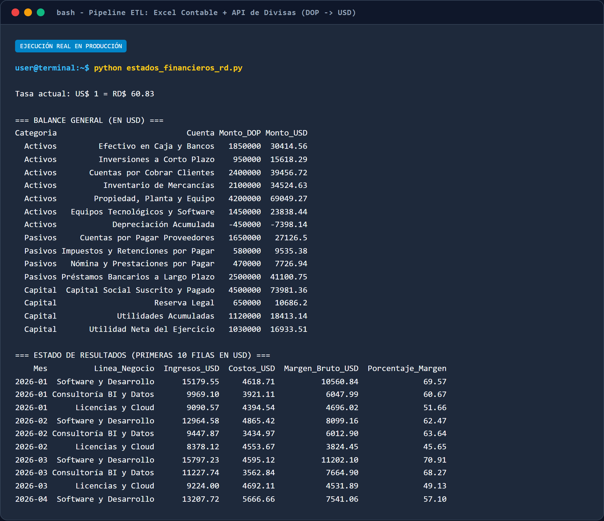
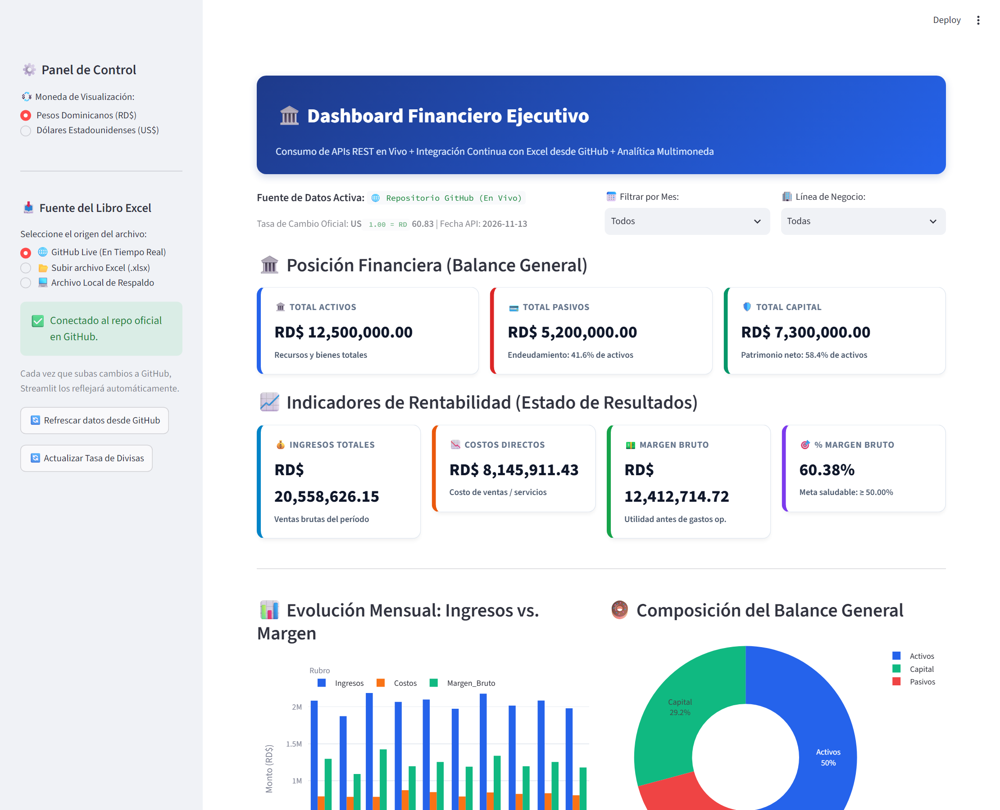

# 🌐 Ecosistema de APIs en Python: Casos Reales y Productivos
### *Integración de APIs REST, Pipelines ETL con Excel Contable y Dashboard Ejecutivo en Streamlit Cloud*

[](https://www.python.org/)
[](https://streamlit.io/)
[](https://pandas.pydata.org/)
[](https://plotly.com/)
[](https://github.com/fawazahmed0/currency-api)
[](https://raw.githubusercontent.com/JUANCITOPENA/APIs-Python-Casos-Reales-Excel-Streamlit/main/estados_financieros_rd.xlsx)
[](https://share.streamlit.io/deploy?repository=JUANCITOPENA/APIs-Python-Casos-Reales-Excel-Streamlit&branch=main&mainModule=app.py)
[](https://github.com/JUANCITOPENA)

---

## 🏛️ Arquitectura Central del Proyecto

<div align="center">
  
  <p><em><strong>Figura Principal:</strong> Arquitectura API Resiliente: Flujo de peticiones HTTPS (GET), balanceo de carga mediante CDN global (jsDelivr / Cloudflare), procesamiento en memoria con Pandas y contingencia de caché offline.</em></p>
</div>

---

## 📌 1. Visión General del Proyecto

En el desarrollo de software y la ingeniería de datos moderna, **el consumo de APIs es la columna vertebral de la interoperabilidad**. Las organizaciones no operan con datos aislados; requieren conectar fuentes locales y sistemas heredados (como hojas de cálculo en **Excel**) con servicios en la nube en tiempo real (tasas de cambio, inflación, cotizaciones bursátiles o microservicios empresariales).

Este repositorio constituye un **manual de ingeniería y suite práctica completa** diseñada con arquitectura de grado productivo. Presenta **tres niveles progresivos de implementación** que abarcan desde el consumo elemental de una API pública hasta la construcción y despliegue de una plataforma web interactiva de Inteligencia de Negocios (**BI**) desplegada en la nube con **Streamlit Community Cloud**, alimentada de forma continua por un archivo **Excel sincronizado en vivo desde GitHub**.

---

## 🧠 2. Fundamentos de APIs: Tipos, Protocolos y Verbos HTTP

Para comprender a fondo la arquitectura de este proyecto, es imprescindible dominar los conceptos que rigen la comunicación entre clientes y servidores en la web.

### 2.1. ¿Qué es una API?
Una **API** (*Application Programming Interface* o Interfaz de Programación de Aplicaciones) es un contrato y puente de comunicación estructurado que permite que dos sistemas de software intercambien datos e instrucciones sin importar el lenguaje de programación o sistema operativo en el que fueron desarrollados.

### 2.2. Tipo de API Utilizada en este Proyecto: RESTful JSON API
* **Arquitectura REST (*Representational State Transfer*):** Se rige por los principios de arquitectura sin estado (*Stateless*), donde cada petición enviada desde nuestro script de Python contiene toda la información necesaria para que el servidor responda de manera independiente.
* **Formato de Entrega JSON (*JavaScript Object Notation*):** El servidor entrega los datos en un formato estándar ligero compuesto por pares clave-valor y arreglos, directamente mapeable a los diccionarios (`dict`) y listas (`list`) de Python.
* **Modelo sin Autenticación (*No-Auth / Public API*):** La API de divisas utilizada está diseñada para alta disponibilidad pública sin fricción de llaves API (*API Keys*), ideal para entornos educativos, dashboards financieros y microservicios de cotización.

### 2.3. Protocolo de Comunicación: HTTP / HTTPS
La transferencia de datos se realiza sobre el protocolo **HTTPS** (*Hypertext Transfer Protocol Secure*), el cual opera sobre el puerto estándar **443** cifrado mediante **TLS/SSL**. Esto asegura que las peticiones entre nuestra máquina (o el servidor en la nube de Streamlit) y los nodos de la API viajen de forma segura, íntegra e inmutable.

### 2.4. Matriz de Verbos HTTP y Justificación de Uso

En la arquitectura REST, los verbos HTTP definen la acción semántica que se desea ejecutar sobre un recurso:

| Verbo HTTP | Operación CRUD | Idempotente | Seguro (Safe) | Propósito en la Web | ¿Usado en este Repo? |
| :---: | :---: | :---: | :---: | :--- | :---: |
| **`GET`** | **Read (Lectura)** | **Sí** | **Sí** | **Consultar y recuperar datos de un recurso existente sin alterar el estado del servidor.** | **✅ SÍ (Exclusivo)** |
| **`POST`** | Create (Creación) | No | No | Enviar nueva información para que el servidor cree un recurso o ejecute un proceso. | ❌ No requerido |
| **`PUT`** | Update (Reemplazo) | Sí | No | Reemplazar completamente un recurso existente con una nueva versión. | ❌ No requerido |
| **`PATCH`** | Update (Parcial) | No | No | Modificar campos específicos de un recurso sin sustituirlo por completo. | ❌ No requerido |
| **`DELETE`** | Delete (Eliminación) | Sí | No | Borrar permanentemente un recurso alojado en el servidor. | ❌ No requerido |

> 💡 **¿Por qué usamos exclusivamente `GET` en este proyecto?**  
> Porque el objetivo de una aplicación de consulta financiera es **leer indicadores oficiales** (cotizaciones de divisas y libros contables) de forma confiable, repetible y rápida. La naturaleza **segura e idempotente** del verbo `GET` permite además que las redes de distribución de contenido (**CDN**) almacenen las respuestas en memoria caché distribuida, reduciendo los tiempos de respuesta a milisegundos.

### 2.5. Códigos de Estado HTTP Manejados

El código de Python implementa manejo defensivo de respuestas de red:

| Código HTTP | Significado | Comportamiento en la Aplicación |
| :---: | :---: | :--- |
| **`200 OK`** | Petición exitosa | El JSON es deserializado y los datos se procesan en memoria. |
| **`404 Not Found`** | Recurso no encontrado | Se activa el intento con el endpoint espejo alternativo. |
| **`429 Too Many Requests`** | Límite de peticiones | Mitigado por el uso de CDN de alto rendimiento sin cuota restrictiva. |
| **`500 / 502 / 503`** | Fallo del servidor remoto | Activa inmediatamente el switch al servidor secundario en Cloudflare. |
| **`Timeout`** | Sin conexión de red | El sistema captura la excepción y aplica la tasa de contingencia offline. |

---

## 🚀 3. Tres Casos de Uso Reales y Productivos (Con Resultados Reales)

El repositorio organiza el aprendizaje y la ejecución en tres niveles progresivos:

### 🔹 Nivel 1: Monitor de Divisas Multimoneda en Tiempo Real (`divisas.py`)
* **Propósito:** Conectar a la API, extraer las tasas del Peso Dominicano (**DOP**), invertir la tasa matemática (`1 / tasa`) para calcular el costo en RD$ de las principales 10 monedas internacionales (USD, EUR, GBP, CHF, CAD, AUD, JPY, CNY, MXN, SGD) y presentarlas ordenadas de mayor a menor valor en la consola.
* **Componentes clave:** Petición HTTP resiliente con `requests`, manejo de excepciones `RequestException`, bucle iterativo de respaldo y ordenamiento de tuplas en Python.

<div align="center">
  
  <p><em><strong>Figura 1:</strong> Ejecución real en terminal de <code>divisas.py</code> mostrando el tipo de cambio oficial ordenado de mayor a menor frente al Peso Dominicano.</em></p>
</div>

---

### 🔹 Nivel 2: Pipeline ETL Híbrido Contable: Excel + API Divisas (`estados_financieros_rd.py`)
* **Propósito:** Integrar una fuente de datos corporativa estática (**Microsoft Excel**) con un servicio web en vivo (**API REST**).
* **Solución a problema real de ingeniería de datos:** Cuando un archivo `.xlsx` contiene fórmulas generadas por software, las celdas carecen de valores en caché si no se abrieron previamente en la aplicación de escritorio de Excel, arrojando valores `NaN` (*Not a Number*) en Pandas. Este script recalcula los márgenes brutos y porcentajes directamente en memoria y convierte Balance General y Estado de Resultados de **DOP** a **USD** con precisión de 2 decimales.

<div align="center">
  
  <p><em><strong>Figura 2:</strong> Ejecución real en terminal de <code>estados_financieros_rd.py</code> procesando el Balance General y Estado de Resultados convertidos de DOP a USD.</em></p>
</div>

---

### 🔹 Nivel 3: Dashboard Ejecutivo Sincronizado en Vivo con GitHub (`app.py` / `estados_financieros_rd_Streamlit_GitHub.py`)
* **Propósito:** Aplicación Web analítica completa lista para producción y despliegue en la nube, con **consumo en tiempo real del archivo Excel alojado en el repositorio de GitHub**.
* **Arquitectura de Sincronización Continua con GitHub:**
  * El dashboard descarga automáticamente la última versión del archivo `estados_financieros_rd.xlsx` directamente desde la URL Raw de GitHub:  
    `https://raw.githubusercontent.com/JUANCITOPENA/APIs-Python-Casos-Reales-Excel-Streamlit/main/estados_financieros_rd.xlsx`
  * Incorpora parámetros **anticaché de CDN** (`?v=timestamp`) y caché reactiva `@st.cache_data(ttl=60)`.
  * **Actualización en Caliente:** Si subes una nueva versión del Excel a GitHub (con más meses, líneas de negocio o cuentas), Streamlit detectará los nuevos datos automáticamente o al presionar el botón **"🔄 Refrescar datos desde GitHub"**, sin necesidad de reiniciar el servidor.
* **Características:**
  1. **Lienzo Ejecutivo con Estilo Bento:** Tarjetas KPI con bordes reforzados, sombra física y acento cromático lateral azul, verde y rojo.
  2. **Conmutador Multimoneda Dinámico:** Selector en tiempo real entre **Pesos Dominicanos (RD$)** y **Dólares Estadounidenses (US$)**.
  3. **Visualizaciones Interactivas con Plotly:** Gráficos de barras agrupadas y gráfico donut de composición del balance.
  4. **Tablas Financieras Semafóricas:** Formato condicional de celdas con semáforo verde (Margen ≥ 50%), amarillo (40% - 49%) y rojo (< 40%).
  5. **Selector de Fuente Flexible:** Permite alternar entre **GitHub Live**, **Subida manual de archivo (.xlsx)** y **Archivo Local de respaldo**.

<div align="center">
  
  <p><em><strong>Figura 3:</strong> Interfaz del Dashboard Ejecutivo en Streamlit funcionando en vivo: Tarjetas Bento, Gráficos Plotly, Tablas con formato condicional y selector de moneda DOP / USD sincronizado con GitHub.</em></p>
</div>

---

## 📂 4. Estructura del Repositorio

```text
├── Arquitectura API resiliente_ Flujo y caché offline.png   # Imagen original de arquitectura del proyecto
├── arquitectura_api_resiliente.png                          # Imagen central de arquitectura para visualización web
├── resultado_proyecto1_divisas.png                          # Captura del resultado del Proyecto 1 (Consola)
├── resultado_proyecto2_etl_excel.png                        # Captura del resultado del Proyecto 2 (Consola ETL)
├── resultado_proyecto3_dashboard_streamlit.png              # Captura del Dashboard interactivo en Streamlit
├── app.py                                                   # Punto de entrada para Streamlit Community Cloud (GitHub Sync)
├── estados_financieros_rd_Streamlit_GitHub.py               # Versión del dashboard con consumo directo desde GitHub
├── estados_financieros_rd_Stramlit.py                       # Código original del Dashboard interactivo
├── estados_financieros_rd.py                                # Pipeline ETL de consola (Excel + API)
├── divisas.py                                               # Script de consumo directo de API de divisas
├── estados_financieros_rd.xlsx                              # Libro contable maestro con Balance y Resultados
├── requirements.txt                                         # Dependencias oficiales para ejecución y despliegue
├── .gitignore                                               # Filtros de exclusión para Git (ignora venv y temporales)
├── README.md                                                # Documentación maestra y presentación del proyecto
├── MANUAL_CREACION_REPO_Y_DESPLIEGUE.md                     # Guía paso a paso: GitHub (Manual + CLI) y Streamlit Cloud
├── gu_a_de_consumo_de_api_de_divisas_en_python.md           # Guía pedagógica del Script 1
├── gu_a_de_conversi_n_de_estados_financieros_excel_a_d_... # Guía pedagógica del Script 2
└── gu_a_completa_dashboard_financiero_en_streamlit_y_...   # Guía pedagógica del Script 3
```

---

## 🛠️ 5. Instalación y Ejecución Local

Sigue estos sencillos pasos para clonar y ejecutar el ecosistema en tu propia computadora:

### Paso 1: Clonar el repositorio
```bash
git clone https://github.com/JUANCITOPENA/APIs-Python-Casos-Reales-Excel-Streamlit.git
cd APIs-Python-Casos-Reales-Excel-Streamlit
```

### Paso 2: Crear y activar un entorno virtual
* **En Windows (PowerShell):**
  ```powershell
  python -m venv venv
  .\venv\Scripts\Activate.ps1
  ```
* **En Linux / macOS:**
  ```bash
  python3 -m venv venv
  source venv/bin/activate
  ```

### Paso 3: Instalar dependencias
```bash
pip install -r requirements.txt
```

### Paso 4: Ejecutar los ejercicios
* **Ejecutar el monitor de divisas:**
  ```bash
  python divisas.py
  ```
* **Ejecutar el pipeline ETL Excel + API:**
  ```bash
  python estados_financieros_rd.py
  ```
* **Lanzar el Dashboard en Streamlit:**
  ```bash
  streamlit run app.py
  ```
  *(Se abrirá automáticamente en tu navegador web en `http://localhost:8501`).*

---

## ☁️ 6. Despliegue en la Nube (Streamlit Community Cloud)

Puedes publicar este Dashboard en la nube de forma **100% gratuita y en un solo clic** utilizando el siguiente enlace directo oficial de Streamlit:

<div align="center">
  <a href="https://share.streamlit.io/deploy?repository=JUANCITOPENA/APIs-Python-Casos-Reales-Excel-Streamlit&branch=main&mainModule=app.py" target="_blank">
    
  </a>
  <p>🚀 <strong>Enlace Directo de Despliegue Automatizado (1 Clic):</strong><br>
  <a href="https://share.streamlit.io/deploy?repository=JUANCITOPENA/APIs-Python-Casos-Reales-Excel-Streamlit&branch=main&mainModule=app.py" target="_blank">
    <strong>https://share.streamlit.io/deploy?repository=JUANCITOPENA/APIs-Python-Casos-Reales-Excel-Streamlit&branch=main&mainModule=app.py</strong>
  </a></p>
</div>

Al hacer clic en el botón o enlace anterior, Streamlit Community Cloud abrirá automáticamente el panel con el repositorio (`JUANCITOPENA/APIs-Python-Casos-Reales-Excel-Streamlit`), la rama (`main`) y el archivo de entrada (`app.py`) ya configurados, dejándote a solo un clic de presionar **"Deploy!"**.

Para el paso a paso detallado y el método alternativo, consulta el manual complementario:  
👉 **[MANUAL_CREACION_REPO_Y_DESPLIEGUE.md](MANUAL_CREACION_REPO_Y_DESPLIEGUE.md)**

---

<!-- =========================================================================
     SECCIÓN OFICIAL: BIOGRAFÍA PROFESIONAL, STACK Y FOOTER INSTITUCIONAL JPV
========================================================================== -->

<table width="100%" cellpadding="12" cellspacing="0" style="border: 2px solid #000000; border-collapse: collapse; background-color: #FFFFFF;">
<tr>
<td width="58%" valign="top" style="border-right: 1.5px solid #000000; padding: 18px;">

<table width="100%" cellpadding="0" cellspacing="0" style="border: none;">
<tr>
<td width="95" valign="top">
  <a href="https://github.com/JUANCITOPENA">
    
  </a>
</td>
<td valign="top" style="padding-left: 12px;">
  <h3 style="margin: 0 0 6px 0; color: #000000;">Ing. Juancito Peña Vizcaíno</h3>
  <a href="#"></a>
  <a href="#"></a>
  <a href="#"></a>
  <a href="#"></a>
</td>
</tr>
</table>

<p style="color: #0F172A; font-size: 13.5px; line-height: 1.6; margin-top: 14px;">
<strong>Ingeniero en Sistemas y Computación</strong> con Postgrado en <strong>Ingeniería de Software</strong> y Maestría en <strong>Sistemas Mención Gerencial</strong> (<em>Universidad Dominicana O&M</em>). Con más de <strong>15 años de trayectoria</strong>, transformo problemas de alta complejidad en soluciones escalables. Durante el último año, he centrado mi trabajo en <strong>I+D+i (Investigación, Desarrollo e Innovación)</strong>, explorando arquitecturas de <strong>IA Generativa (RAG / LLMs)</strong>, integración de agentes autónomos con bases de datos y orquestación de APIs empresariales.
</p>

<p style="color: #0F172A; font-size: 13.5px; line-height: 1.6; margin-bottom: 0;">
🔬 <strong>Mi motor es el aprendizaje a través de los retos:</strong> me apasionan los <em>casos de uso reales</em>, las <strong>pruebas técnicas rigurosas</strong>, la investigación profunda y el diseño de soluciones directas a problemas de ingeniería. 🎓 Como <strong>docente universitario</strong> y creador del canal educativo <strong><a href="https://www.youtube.com/@JuancitoDevV">@JuancitoDevV</a></strong>, comparto este conocimiento práctico mediante ejercicios y proyectos de código abierto para acercar la tecnología a problemas reales. 🚀
</p>

</td>
<td width="42%" valign="top" style="padding: 18px;">

<h4 style="margin: 0 0 10px 0; color: #000000;">⚡ Ecosistema de Tecnologías:</h4>

<p style="margin: 0 0 8px 0; font-size: 12.5px; line-height: 1.5;">
<strong>🖥️ Frontend & Web:</strong><br>
<code>HTML5</code> • <code>CSS3</code> • <code>JavaScript</code> • <code>React</code> • <code>Next.js</code><br>


</p>

<p style="margin: 0 0 8px 0; font-size: 12.5px; line-height: 1.5;">
<strong>⚙️ Backend & Multiplataforma:</strong><br>
<code>C#</code> • <code>.NET / MAUI</code> • <code>Python</code> • <code>PHP</code><br>


</p>

<p style="margin: 0 0 8px 0; font-size: 12.5px; line-height: 1.5;">
<strong>📊 Data Analytics & Bases de Datos:</strong><br>
<code>SQL Server</code> • <code>PostgreSQL</code> • <code>MySQL</code> • <code>Power BI</code><br>


📊
</p>

<p style="margin: 0 0 12px 0; font-size: 12.5px; line-height: 1.5;">
<strong>🤖 IA + APIs & Despliegue (I+D+i):</strong><br>
<code>APIs REST</code> • <code>LLMs (RAG)</code> • <code>Agentes IA</code> • <code>Git</code> • <code>GitHub</code> • <code>Vercel</code><br>
🔌 🧠 🤖


▲
</p>

<h4 style="margin: 12px 0 6px 0; color: #000000;">Canales Oficiales & Redes:</h4>

<p style="margin: 0 0 10px 0;">
  <a href="https://www.linkedin.com/in/juancitope%C3%B1a/"></a>
  <a href="https://www.youtube.com/@JuancitoDevV"></a>
  <a href="https://github.com/JUANCITOPENA"></a>
  <a href="https://twitter.com/JuancitoPenaV"></a>
  <a href="mailto:juancito.pena@gmail.com"></a>
</p>

<table width="100%" cellpadding="6" cellspacing="0" style="border: 1.5px solid #000000; background-color: #F8FAFC;">
<tr>
<td>
  <small style="color: #DC2626; font-weight: bold; display: block;">Canal Educativo de YouTube:</small>
  <a href="https://www.youtube.com/@JuancitoDevV" style="font-weight: bold; color: #000000; text-decoration: none; font-size: 13px;">
    ▶️ @JuancitoDevV · Algoritmos, SQL, IA & .NET ↗
  </a>
</td>
</tr>
</table>

</td>
</tr>
</table>

<table width="100%" cellpadding="12" cellspacing="0" style="border: 2px solid #000000; border-top: none; background-color: #F1F5F9;">
<tr>
<td width="75%">
  <span style="background-color: #000000; color: #FFFFFF; padding: 2px 8px; font-size: 11px; font-weight: bold; margin-right: 8px;">PROYECTO OFICIAL JPV</span>
  <strong>Sistemas, Datos & Arquitectura de Software</strong>
  <p style="margin: 4px 0 0 0; font-size: 12px; color: #475569;">
    Plataforma de grado industrial desarrollada bajo estándares de alto rendimiento, accesibilidad universal y diseño limpio.
  </p>
  <p style="margin: 4px 0 0 0; font-size: 11px; color: #64748B;">
    <strong>Aviso Académico & Autoría:</strong> Diseñado, desarrollado y certificado por el <strong>Ing. Juancito Peña Vizcaíno</strong>. Todos los derechos reservados.
  </p>
</td>
<td width="25%" align="right" valign="middle">
  <a href="#top" style="color: #DC2626; font-weight: bold; text-decoration: none; font-size: 13px;">
    ⬆️ Volver al Inicio
  </a>
</td>
</tr>
</table>
