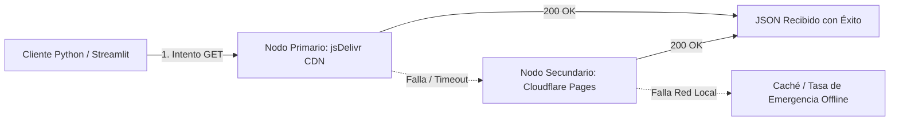

# 🌐 Ecosistema de APIs en Python: Casos Reales y Productivos
### *Integración de APIs REST, Pipelines ETL con Excel Contable y Dashboard Ejecutivo en Streamlit Cloud*

[](https://www.python.org/)
[](https://streamlit.io/)
[](https://pandas.pydata.org/)
[](https://plotly.com/)
[](https://github.com/fawazahmed0/currency-api)
[]()
[](https://github.com/JUANCITOPENA)

---

## 📌 1. Visión General del Proyecto

En el desarrollo de software y la ingeniería de datos moderna, **el consumo de APIs es la columna vertebral de la interoperabilidad**. Las organizaciones no operan con datos aislados; requieren conectar fuentes locales y sistemas heredados (como hojas de cálculo en **Excel**) con servicios en la nube en tiempo real (tasas de cambio, inflación, cotizaciones bursátiles o microservicios empresariales).

Este repositorio constituye un **manual de ingeniería y suite práctica completa** diseñada con arquitectura de grado productivo. Presenta **tres niveles progresivos de implementación** que abarcan desde el consumo elemental de una API pública hasta la construcción y despliegue de una plataforma web interactiva de Inteligencia de Negocios (**BI**) desplegada en la nube con **Streamlit Community Cloud**.

---

## 🧠 2. Fundamentos de APIs: Tipos, Protocolos y Verbos HTTP

Para comprender a fondo la arquitectura de este proyecto, es imprescindible dominar los conceptos que rigen la comunicación entre clientes y servidores en la web.

### 2.1. ¿Qué es una API?
Una **API** (*Application Programming Interface* o Interfaz de Programación de Aplicaciones) es un contrato y puente de comunicación estructurado que permite que dos sistemas de software intercambien datos e instrucciones sin importar el lenguaje de programación o sistema operativo en el que fueron desarrollados.

### 2.2. Tipo de API Utilizada en este Proyecto: RESTful JSON API
* **Arquitectura REST (*Representational State Transfer*):** Se rige por los principios de arquitectura sin estado (*Stateless*), donde cada petición enviada desde nuestro script de Python contiene toda la información necesaria para que el servidor responda de manera independiente.
* **Formato de Entrega JSON (*JavaScript Object Notation*):** El servidor entrega los datos en un formato estándar ligero compuesto por pares clave-valor y arreglos, directamente mapeable a los diccionarios (`dict`) y listas (`list`) de Python.
* **Modelo sin Autenticación (*No-Auth / Public API*):** La API utilizada está diseñada para alta disponibilidad pública sin fricción de llaves API (*API Keys*), ideal para entornos educativos, dashboards financieros y microservicios de cotización.

### 2.3. Protocolo de Comunicación: HTTP / HTTPS
La transferencia de datos se realiza sobre el protocolo **HTTPS** (*Hypertext Transfer Protocol Secure*), el cual opera sobre el puerto estándar **443** cifrado mediante **TLS/SSL**. Esto asegura que las peticiones entre nuestra máquina (o el servidor en la nube de Streamlit) y los nodos de la API viajen de forma segura, íntegra e inmutable.

### 2.4. Matriz de Verbos HTTP y Justificación de Uso

En la arquitectura REST, los verbos HTTP definen la acción semántica que se desea ejecutar sobre un recurso:

| Verbo HTTP | Operación CRUD | Idempotente | Seguro (Safe) | Propósito en la Web | ¿Usado en este Repo? |
| :---: | :---: | :---: | :---: | :--- | :---: |
| **`GET`** | **Read (Lectura)** | **Sí** | **Sí** | **Consultar y recuperar datos de un recurso existente sin alterar el estado del servidor.** | **✅ SÍ (Exclusivo)** |
| **`POST`** | Create (Creación) | No | No | Enviar nueva información para que el servidor cree un recurso o ejecute un proceso. | ❌ No requerido |
| **`PUT`** | Update (Reemplazo) | Sí | No | Reemplazar completamente un recurso existente con una nueva versión. | ❌ No requerido |
| **`PATCH`** | Update (Parcial) | No | No | Modificar campos específicos de un recurso sin sustituirlo por completo. | ❌ No requerido |
| **`DELETE`** | Delete (Eliminación) | Sí | No | Borrar permanentemente un recurso alojado en el servidor. | ❌ No requerido |

> 💡 **¿Por qué usamos exclusivamente `GET` en este proyecto?**  
> Porque el objetivo de una aplicación de consulta financiera es **leer indicadores oficiales** (cotizaciones de divisas) de forma confiable, repetible y rápida. La naturaleza **segura e idempotente** del verbo `GET` permite además que las redes de distribución de contenido (**CDN**) almacenen las respuestas en memoria caché distribuida, reduciendo los tiempos de respuesta a milisegundos.

### 2.5. Códigos de Estado HTTP Manejados

El código de Python implementa manejo defensivo de respuestas de red:

```text
┌─────────────────┬────────────────────────────────────────────────────────┐
│ Código HTTP     │ Significado y Comportamiento en la Aplicación          │
├─────────────────┼────────────────────────────────────────────────────────┤
│ 200 OK          │ Petición exitosa. El JSON es parseado y procesado.     │
│ 404 Not Found   │ La divisa o el endpoint no existe en la ruta.          │
│ 429 Too Many    │ Límite de tasa excedido (mitigado por el uso de CDN).  │
│ 500 / 502 / 503 │ Error de servidor (activador automático de Fallback).  │
│ Timeout         │ Red bloqueada o caída (activa servidor alternativo).   │
└─────────────────┴────────────────────────────────────────────────────────┘
```

### 2.6. Arquitectura de Alta Disponibilidad y Resiliencia (Redundancia CDN)
Para evitar que el dashboard colapse ante caídas de proveedores de red, el código implementa un **patrón de redundancia con fallback**:



---

## 🚀 3. Tres Casos de Uso Reales y Productivos

El repositorio organiza el aprendizaje y la ejecución en tres niveles progresivos:

### 🔹 Nivel 1: Monitor de Divisas Multimoneda en Tiempo Real (`divisas.py`)
* **Propósito:** Conectar a la API, extraer las tasas del Peso Dominicano (**DOP**), invertir la tasa matemática (`1 / tasa`) para obtener el costo en RD$ de las principales 10 monedas internacionales (USD, EUR, GBP, CHF, CAD, AUD, JPY, CNY, MXN, SGD) y presentarlas ordenadas de mayor a menor valor en la consola.
* **Componentes clave:** Petición HTTP resiliente con `requests`, manejo de excepciones `RequestException`, bucle iterativo de respaldo y ordenamiento de tuplas en Python.

### 🔹 Nivel 2: Pipeline ETL Híbrido Contable: Excel + API Divisas (`estados_financieros_rd.py`)
* **Propósito:** Integrar una fuente de datos corporativa estática (**Microsoft Excel**) con un servicio web en vivo (**API REST**).
* **Solución a problema real de ingeniería de datos:** Cuando un archivo `.xlsx` contiene fórmulas generadas por software, las celdas carecen de valores en caché si no se abrieron previamente en la aplicación de escritorio de Excel, arrojando valores `NaN` (*Not a Number*) en Pandas. Este script recalcula los márgenes brutos y porcentajes directamente en memoria y convierte Balance General y Estado de Resultados de **DOP** a **USD** con precisión de 2 decimales.

### 🔹 Nivel 3: Dashboard Ejecutivo de Business Intelligence (`app.py` / `estados_financieros_rd_Stramlit.py`)
* **Propósito:** Aplicación Web analítica completa lista para producción y despliegue en la nube.
* **Características:**
  1. **Lienzo Ejecutivo con Estilo Bento:** Tarjetas KPI con bordes reforzados, sombra física y acento cromático lateral azul, verde y rojo.
  2. **Conmutador Multimoneda Dinámico:** Selector en tiempo real entre **Pesos Dominicanos (RD$)** y **Dólares Estadounidenses (US$)** que recalcula instantáneamente todas las tarjetas, gráficos y tablas.
  3. **Visualizaciones Interactivas con Plotly:**
     * *Evolución Mensual agrupada:* Ingresos vs. Costos vs. Margen Bruto.
     * *Composición del Balance:* Donut Chart proporcional de Activos, Pasivos y Capital.
  4. **Tablas Financieras Semafóricas:** Formato condicional de celdas con semáforo verde (Margen ≥ 50%), amarillo (40% - 49%) y rojo (< 40%).
  5. **Cargador de Archivos en Caliente:** Permite al usuario arrastrar su propio archivo Excel de estados financieros y analizarlo al instante.
  6. **Optimización con `@st.cache_data`:** Consulta la API con caducidad controlada (*TTL*) de 1 hora para evitar consumo innecesario de ancho de banda.

---

## 📂 4. Estructura del Repositorio

```text
├── app.py                                                   # Punto de entrada estándar para Streamlit Community Cloud
├── estados_financieros_rd_Stramlit.py                       # Código fuente del Dashboard interactivo
├── estados_financieros_rd.py                                # Pipeline ETL de consola (Excel + API)
├── divisas.py                                               # Script de consumo directo de API de divisas
├── estados_financieros_rd.xlsx                              # Libro contable maestro con Balance y Resultados
├── requirements.txt                                         # Dependencias oficiales para ejecución y despliegue
├── .gitignore                                               # Filtros de exclusión para Git (ignora venv y temporales)
├── README.md                                                # Documentación maestra y presentación del proyecto
├── MANUAL_CREACION_REPO_Y_DESPLIEGUE.md                     # Guía paso a paso: GitHub (Manual + CLI) y Streamlit Cloud
├── gu_a_de_consumo_de_api_de_divisas_en_python.md           # Guía pedagógica del Script 1
├── gu_a_de_conversi_n_de_estados_financieros_excel_a_d_... # Guía pedagógica del Script 2
└── gu_a_completa_dashboard_financiero_en_streamlit_y_...   # Guía pedagógica del Script 3
```

---

## 🛠️ 5. Instalación y Ejecución Local

Sigue estos sencillos pasos para clonar y ejecutar el ecosistema en tu propia computadora:

### Paso 1: Clonar el repositorio
```bash
git clone https://github.com/JUANCITOPENA/APIs-Python-Casos-Reales-Excel-Streamlit.git
cd APIs-Python-Casos-Reales-Excel-Streamlit
```

### Paso 2: Crear y activar un entorno virtual
* **En Windows (PowerShell):**
  ```powershell
  python -m venv venv
  .\venv\Scripts\Activate.ps1
  ```
* **En Linux / macOS:**
  ```bash
  python3 -m venv venv
  source venv/bin/activate
  ```

### Paso 3: Instalar dependencias
```bash
pip install -r requirements.txt
```

### Paso 4: Ejecutar los ejercicios
* **Ejecutar el monitor de divisas:**
  ```bash
  python divisas.py
  ```
* **Ejecutar el pipeline ETL Excel + API:**
  ```bash
  python estados_financieros_rd.py
  ```
* **Lanzar el Dashboard en Streamlit:**
  ```bash
  streamlit run app.py
  ```
  *(Se abrirá automáticamente en tu navegador web en `http://localhost:8501`).*

---

## ☁️ 6. Despliegue en la Nube (Streamlit Community Cloud)

El proyecto está 100% preparado para ser desplegado gratis en la nube con un solo clic. Consulta el manual complementario:
👉 **[MANUAL_CREACION_REPO_Y_DESPLIEGUE.md](MANUAL_CREACION_REPO_Y_DESPLIEGUE.md)** para conocer las instrucciones detalladas con el método de arrastrar y soltar, comandos de Git y configuración en Streamlit Cloud.

---

<!-- =========================================================================
     SECCIÓN: BIOGRAFÍA PROFESIONAL, FILOSOFÍA & STACK TÉCNICO (ING. JUANCITO PEÑA)
========================================================================== -->
<div align="center" style="margin-top: 40px; margin-bottom: 20px;">
  <hr style="border: 2px solid #000000; margin-bottom: 30px;" />
</div>

<div style="background: #FFFFFF; border: 2.5px solid #000000; border-radius: 14px; padding: 2rem; box-shadow: 6px 6px 0px #000000; margin-bottom: 2rem;">
  <div style="display: flex; flex-wrap: wrap; align-items: center; gap: 2rem;">
    
    <!-- LATERAL IZQUIERDO: BIOGRAFÍA, FILOSOFÍA Y DOCENCIA -->
    <div style="flex: 1 1 480px;">
      
      <!-- Encabezado con Avatar Oficial y Badges -->
      <div style="display: flex; align-items: center; gap: 1rem; margin-bottom: 1rem;">
        
        <div>
          <h3 style="color: #000000; font-weight: 800; margin: 0 0 6px 0;">Ing. Juancito Peña Vizcaíno</h3>
          <div style="display: flex; flex-wrap: wrap; gap: 6px;">
            <span style="background: #000000; color: #FFFFFF; padding: 3px 10px; border-radius: 6px; font-size: 0.75rem; font-weight: bold;">Data Analyst</span>
            <span style="background: #DA291C; color: #FFFFFF; padding: 3px 10px; border-radius: 6px; font-size: 0.75rem; font-weight: bold;">Full Stack Dev</span>
            <span style="background: #0D6EFD; color: #FFFFFF; padding: 3px 10px; border-radius: 6px; font-size: 0.75rem; font-weight: bold;">AI &amp; API Expert</span>
            <span style="background: #FFC107; color: #000000; padding: 3px 10px; border-radius: 6px; font-size: 0.75rem; font-weight: bold;">Líder I+D+i</span>
          </div>
        </div>
      </div>
      
      <!-- PÁRRAFO 1: Trayectoria, Formación y Foco en I+D+i -->
      <p style="color: #0F172A; font-weight: 500; line-height: 1.65; margin-bottom: 0.75rem;">
        <strong>Ingeniero en Sistemas y Computación</strong> con Postgrado en <strong>Ingeniería de Software</strong> y Maestría en <strong>Sistemas Mención Gerencial</strong> (<em>Universidad Dominicana O&amp;M</em>). Con más de <strong>15 años de trayectoria</strong>, transformo problemas de alta complejidad en soluciones escalables. Durante el último año, he centrado mi trabajo en <strong>I+D+i (Investigación, Desarrollo e Innovación)</strong>, explorando arquitecturas de <strong>IA Generativa (RAG / LLMs)</strong>, integración de agentes autónomos con bases de datos y orquestación de APIs empresariales.
      </p>

      <!-- PÁRRAFO 2: ADN Técnico, Pasión por los Casos de Uso y Docencia Práctica -->
      <p style="color: #0F172A; font-weight: 500; line-height: 1.65; margin: 0;">
        🔬 <strong>Mi motor es el aprendizaje a través de los retos:</strong> me apasionan los <em>casos de uso reales</em>, las <strong>pruebas técnicas rigurosas</strong>, la investigación profunda y el diseño de soluciones directas a problemas de ingeniería. 🎓 Como <strong>docente universitario</strong> y creador del canal educativo <strong>@JuancitoDevV</strong>, comparto este conocimiento práctico mediante ejercicios y proyectos de código abierto para acercar la tecnología a problemas reales. 🚀
      </p>

    </div>

    <!-- LATERAL DERECHO: STACK VISUAL AGRUPADO & CANALES OFICIALES -->
    <div style="flex: 1 1 380px;">
      
      <div style="margin-bottom: 1.25rem;">
        <h4 style="font-weight: 800; margin: 0 0 10px 0; color: #000000;">
          ⚡ Ecosistema de Tecnologías:
        </h4>

        <!-- 1. Frontend & Web -->
        <div style="margin-bottom: 8px;">
          <small style="display: block; font-weight: bold; color: #000000; font-size: 0.8rem; margin-bottom: 3px;">🖥️ Frontend &amp; Web:</small>
          <span style="display: inline-block; background: #FFFFFF; border: 1.5px solid #000000; padding: 2px 8px; border-radius: 6px; font-size: 0.78rem; font-weight: bold; margin: 2px; box-shadow: 2px 2px 0 #000000;"> HTML5</span>
          <span style="display: inline-block; background: #FFFFFF; border: 1.5px solid #000000; padding: 2px 8px; border-radius: 6px; font-size: 0.78rem; font-weight: bold; margin: 2px; box-shadow: 2px 2px 0 #000000;"> CSS3</span>
          <span style="display: inline-block; background: #FFFFFF; border: 1.5px solid #000000; padding: 2px 8px; border-radius: 6px; font-size: 0.78rem; font-weight: bold; margin: 2px; box-shadow: 2px 2px 0 #000000;"> JavaScript</span>
          <span style="display: inline-block; background: #FFFFFF; border: 1.5px solid #000000; padding: 2px 8px; border-radius: 6px; font-size: 0.78rem; font-weight: bold; margin: 2px; box-shadow: 2px 2px 0 #000000;"> React</span>
          <span style="display: inline-block; background: #FFFFFF; border: 1.5px solid #000000; padding: 2px 8px; border-radius: 6px; font-size: 0.78rem; font-weight: bold; margin: 2px; box-shadow: 2px 2px 0 #000000;"> Next.js</span>
        </div>

        <!-- 2. Backend & Multiplataforma -->
        <div style="margin-bottom: 8px;">
          <small style="display: block; font-weight: bold; color: #000000; font-size: 0.8rem; margin-bottom: 3px;">⚙️ Backend &amp; Multiplataforma:</small>
          <span style="display: inline-block; background: #FFFFFF; border: 1.5px solid #000000; padding: 2px 8px; border-radius: 6px; font-size: 0.78rem; font-weight: bold; margin: 2px; box-shadow: 2px 2px 0 #000000;"> C#</span>
          <span style="display: inline-block; background: #FFFFFF; border: 1.5px solid #000000; padding: 2px 8px; border-radius: 6px; font-size: 0.78rem; font-weight: bold; margin: 2px; box-shadow: 2px 2px 0 #000000;"> .NET / MAUI</span>
          <span style="display: inline-block; background: #FFFFFF; border: 1.5px solid #000000; padding: 2px 8px; border-radius: 6px; font-size: 0.78rem; font-weight: bold; margin: 2px; box-shadow: 2px 2px 0 #000000;"> Python</span>
          <span style="display: inline-block; background: #FFFFFF; border: 1.5px solid #000000; padding: 2px 8px; border-radius: 6px; font-size: 0.78rem; font-weight: bold; margin: 2px; box-shadow: 2px 2px 0 #000000;"> PHP</span>
        </div>

        <!-- 3. Datos & Analítica -->
        <div style="margin-bottom: 8px;">
          <small style="display: block; font-weight: bold; color: #000000; font-size: 0.8rem; margin-bottom: 3px;">📊 Data Analytics &amp; Bases de Datos:</small>
          <span style="display: inline-block; background: #FFFFFF; border: 1.5px solid #000000; padding: 2px 8px; border-radius: 6px; font-size: 0.78rem; font-weight: bold; margin: 2px; box-shadow: 2px 2px 0 #000000;"> SQL Server</span>
          <span style="display: inline-block; background: #FFFFFF; border: 1.5px solid #000000; padding: 2px 8px; border-radius: 6px; font-size: 0.78rem; font-weight: bold; margin: 2px; box-shadow: 2px 2px 0 #000000;"> PostgreSQL</span>
          <span style="display: inline-block; background: #FFFFFF; border: 1.5px solid #000000; padding: 2px 8px; border-radius: 6px; font-size: 0.78rem; font-weight: bold; margin: 2px; box-shadow: 2px 2px 0 #000000;"> MySQL</span>
          <span style="display: inline-block; background: #FFFFFF; border: 1.5px solid #000000; padding: 2px 8px; border-radius: 6px; font-size: 0.78rem; font-weight: bold; margin: 2px; box-shadow: 2px 2px 0 #000000;">📊 Power BI / DAX</span>
        </div>

        <!-- 4. IA, APIs & Cloud -->
        <div>
          <small style="display: block; font-weight: bold; color: #000000; font-size: 0.8rem; margin-bottom: 3px;">🤖 IA + APIs &amp; Despliegue (I+D+i):</small>
          <span style="display: inline-block; background: #FFFFFF; border: 1.5px solid #000000; padding: 2px 8px; border-radius: 6px; font-size: 0.78rem; font-weight: bold; margin: 2px; box-shadow: 2px 2px 0 #000000;">🔌 APIs REST</span>
          <span style="display: inline-block; background: #FFFFFF; border: 1.5px solid #000000; padding: 2px 8px; border-radius: 6px; font-size: 0.78rem; font-weight: bold; margin: 2px; box-shadow: 2px 2px 0 #000000;">🧠 IA + LLMs (RAG)</span>
          <span style="display: inline-block; background: #FFFFFF; border: 1.5px solid #000000; padding: 2px 8px; border-radius: 6px; font-size: 0.78rem; font-weight: bold; margin: 2px; box-shadow: 2px 2px 0 #000000;">🤖 Agentes IA</span>
          <span style="display: inline-block; background: #FFFFFF; border: 1.5px solid #000000; padding: 2px 8px; border-radius: 6px; font-size: 0.78rem; font-weight: bold; margin: 2px; box-shadow: 2px 2px 0 #000000;"> Git</span>
          <span style="display: inline-block; background: #FFFFFF; border: 1.5px solid #000000; padding: 2px 8px; border-radius: 6px; font-size: 0.78rem; font-weight: bold; margin: 2px; box-shadow: 2px 2px 0 #000000;"> GitHub</span>
          <span style="display: inline-block; background: #FFFFFF; border: 1.5px solid #000000; padding: 2px 8px; border-radius: 6px; font-size: 0.78rem; font-weight: bold; margin: 2px; box-shadow: 2px 2px 0 #000000;">▲ Vercel</span>
        </div>
      </div>

      <!-- Redes Sociales Oficiales -->
      <div>
        <h5 style="font-weight: 800; margin: 0 0 8px 0; color: #000000;">Canales Oficiales &amp; Redes:</h5>
        
        <div style="display: flex; gap: 8px; flex-wrap: wrap; margin-bottom: 12px;">
          <a href="https://www.linkedin.com/in/juancitope%C3%B1a/" target="_blank" style="width: 42px; height: 42px; background: #FFFFFF; border: 2px solid #000000; border-radius: 8px; display: inline-flex; align-items: center; justify-content: center; font-size: 1.2rem; box-shadow: 3px 3px 0px #000000; text-decoration: none;" title="LinkedIn Oficial" rel="noopener noreferrer">
            🔗
          </a>
          <a href="https://www.youtube.com/@JuancitoDevV" target="_blank" style="width: 42px; height: 42px; background: #FFFFFF; border: 2px solid #000000; border-radius: 8px; display: inline-flex; align-items: center; justify-content: center; font-size: 1.2rem; box-shadow: 3px 3px 0px #000000; text-decoration: none;" title="YouTube @JuancitoDevV" rel="noopener noreferrer">
            📺
          </a>
          <a href="https://github.com/JUANCITOPENA" target="_blank" style="width: 42px; height: 42px; background: #FFFFFF; border: 2px solid #000000; border-radius: 8px; display: inline-flex; align-items: center; justify-content: center; font-size: 1.2rem; box-shadow: 3px 3px 0px #000000; text-decoration: none;" title="GitHub @JUANCITOPENA" rel="noopener noreferrer">
            🐙
          </a>
          <a href="https://twitter.com/JuancitoPenaV" target="_blank" style="width: 42px; height: 42px; background: #FFFFFF; border: 2px solid #000000; border-radius: 8px; display: inline-flex; align-items: center; justify-content: center; font-size: 1.2rem; box-shadow: 3px 3px 0px #000000; text-decoration: none;" title="X (Twitter) @JuancitoPenaV" rel="noopener noreferrer">
            🐦
          </a>
          <a href="mailto:juancito.pena@gmail.com" style="width: 42px; height: 42px; background: #FFFFFF; border: 2px solid #000000; border-radius: 8px; display: inline-flex; align-items: center; justify-content: center; font-size: 1.2rem; box-shadow: 3px 3px 0px #000000; text-decoration: none;" title="Correo Electrónico">
            ✉️
          </a>
        </div>

        <!-- Tarjeta Promocional de YouTube -->
        <div style="padding: 10px 14px; background: #FFFFFF; border: 2px solid #000000; border-radius: 8px; box-shadow: 3px 3px 0px #000000;">
          <small style="display: block; font-weight: bold; color: #DC2626;">Canal Educativo de YouTube:</small>
          <a href="https://www.youtube.com/@JuancitoDevV" target="_blank" style="font-weight: 800; color: #000000; text-decoration: none; font-size: 0.9rem;" rel="noopener noreferrer">
            ▶️ @JuancitoDevV · Algoritmos, SQL, IA &amp; .NET ↗
          </a>
        </div>

      </div>

    </div>

  </div>
</div>

<!-- =========================================================================
     FOOTER OFICIAL NEO-BRUTALIST (ING. JUANCITO PEÑA)
========================================================================== -->
<footer style="background: #FFFFFF; border-top: 3px solid #000000; padding: 2rem 1.5rem; width: 100%; color: #000000;">
  <div style="display: flex; justify-content: space-between; align-items: center; flex-wrap: wrap; gap: 1rem;">
    <div>
      <span style="background: #000000; color: #FFFFFF; border: 1.5px solid #000000; padding: 3px 8px; font-size: 0.75rem; font-weight: bold; margin-right: 8px;">PROYECTO OFICIAL JPV</span>
      <strong>Sistemas, Datos &amp; Arquitectura de Software</strong>
      <p style="font-size: 0.85rem; margin: 4px 0 0 0; color: #64748B;">
        Plataforma de grado industrial desarrollada bajo estándares de alto rendimiento, accesibilidad universal y diseño limpio.
      </p>
      <p style="font-size: 0.75rem; margin: 6px 0 0 0; color: #475569;">
        <strong>Aviso Académico &amp; Autoría:</strong> Diseñado, desarrollado y certificado por el <strong>Ing. Juancito Peña Vizcaíno</strong>. Todos los derechos reservados.
      </p>
    </div>
    <div>
      <a href="#" style="color: #DC2626; font-weight: bold; text-decoration: none; font-size: 0.9rem;">
        ⬆️ Volver al Inicio
      </a>
    </div>
  </div>
</footer>
